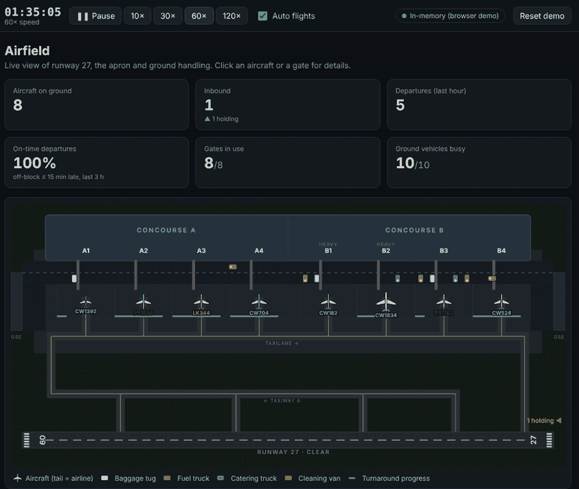
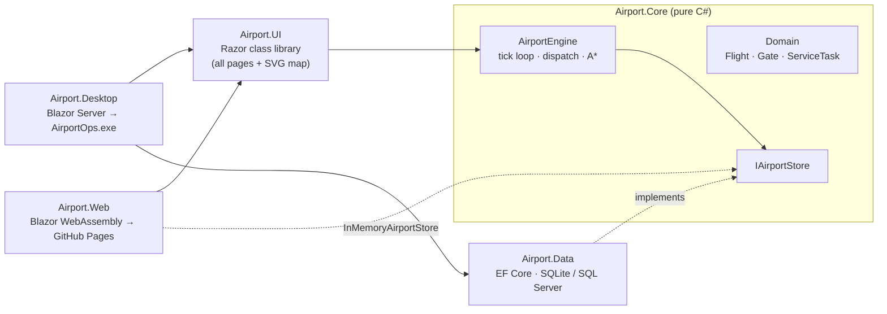

# ✈ Airport Operations Center

A live airport simulation and operations dashboard built with **C#, .NET 10, Blazor, EF Core and SQL**.
Aircraft land on runway 27, taxi on a one-way taxi network to their gates, get turned around by a fleet of
ground vehicles (fuel, catering, cleaning, baggage), and push back for departure. You run the operation:
schedule flights, change gates, close stands, delay or cancel flights, and watch the impact on punctuality.

**▶ [Live demo](https://chase-mulder.github.io/airport-ops/)** (runs entirely in your browser)
**⬇ [Download the Windows app](https://github.com/Chase-Mulder/airport-ops/releases/latest)** (AirportOps.exe, saves to a local SQL database)



> Personal side project by **Chase A. Mulder**. All airlines, registrations and the airport are fictional.

---

## Features

| Screen | What it shows |
|---|---|
| **Airfield** | Animated top-down map: runway, taxiways, 8 gates, aircraft and ground vehicles moving in real time. Click an aircraft for its turnaround progress, or a gate to close it. |
| **Flights** | Flight board with tabs and search. Schedule new flights (validated against aircraft size, minimum turn time and gate conflicts), change gates inline, delay +15, cancel. |
| **Gates** | Gantt-style stand plan for the next 3 hours with conflict highlighting, utilization and the gate planner. |
| **Ground ops** | Turnaround progress per aircraft (6 tasks with dependencies) and the vehicle fleet with utilization. |
| **Performance** | Runway movements per 10 min, on-time performance (A15), average delay, turnaround, taxi-in/out times. |
| **Master data** | Airlines, aircraft types (service durations), gates. |

Demo mode (**Auto flights**) keeps the schedule filled so there is always traffic. Speed: 10× to 120×.

## How it works

- **Gate planning:** each flight gets the smallest compatible stand that is free for its whole ground time (plus buffers). If the stand is still occupied on arrival (a late departure), the flight changes to another free stand or **holds**.
- **Runway sequencing:** the runway is an exclusive resource. When arrivals and departures are both waiting, operations alternate so neither starves.
- **Taxiing:** A* route finding over a **directed** taxi graph (one-way loop), so aircraft can never meet head-on. Movers reserve the next cell before entering it and keep a one-cell gap.
- **Turnaround:** deboarding, baggage, fuel and catering start at on-block; cleaning waits for deboarding; boarding waits for cleaning + catering + fuel and the boarding window; pushback at scheduled departure once everything is done.
- **Ground vehicle dispatch:** ready tasks go to the closest free vehicle of the right type, most urgent departure first. Vehicles re-route around each other when blocked (A* on the service road grid).
- **Persistence:** the engine keeps live state in memory and streams every change through a channel to a background writer (batched EF Core upserts), so the simulation never waits on the database.

## Architecture



One UI library and one engine, two hosts:

| | Desktop (`AirportOps.exe`) | Browser (GitHub Pages) |
|---|---|---|
| Hosting | Blazor Server on a local Kestrel web server | Blazor WebAssembly, static files |
| Storage | SQLite file (default) or SQL Server | In memory |
| Install | None (self-contained .NET) | None |

## Run it

**Visual Studio 2022 17.14+ / 2026** (with the ASP.NET workload and .NET 10 SDK)

1. Open `AirportOps.slnx`.
2. Set **Airport.Desktop** as the startup project and press **F5**.
   Pick the launch profile **AirportOps (SQL Server LocalDB)** to use SQL Server instead of SQLite.

**Command line**

```bash
dotnet run --project src/Airport.Desktop      # desktop edition at http://localhost:5080
dotnet run --project src/Airport.Web          # browser edition
```

**Build the .exe yourself**

```bash
dotnet publish src/Airport.Desktop -c Release -r win-x64 --self-contained -o publish/AirportOps
```

## SQL Server

Switch provider in `src/Airport.Desktop/appsettings.json`:

```json
"Database": {
  "Provider": "SqlServer",
  "ConnectionString": "Server=(localdb)\\MSSQLLocalDB;Database=AirportOps;Trusted_Connection=True;TrustServerCertificate=True"
}
```

The schema is created on first run. Then run [`sql/ReportingViews.sql`](sql/ReportingViews.sql) in SSMS for
reporting views: on-time performance per hour, turnaround by aircraft type, gate utilization and ground handling.

```sql
SELECT * FROM rpt.OnTimePerformance ORDER BY [Hour] DESC;
SELECT * FROM rpt.TurnaroundByAircraftType;
```

## Project layout

```
src/
  Airport.Core/      Domain model, AirportEngine (simulation + commands), A* pathfinder, layout, seed data
  Airport.Data/      EF Core DbContext, batched background writer, provider selection
  Airport.UI/        Razor class library: pages, SVG airfield map, CSS
  Airport.Desktop/   Blazor Server host → AirportOps.exe
  Airport.Web/       Blazor WebAssembly host → GitHub Pages
sql/                 SQL Server reporting views
.github/workflows/   Pages deploy (on push to main) and .exe release (on tag v*)
```

## Releases

```bash
git tag v1.0.0
git push origin v1.0.0
```

GitHub Actions builds the self-contained Windows app and attaches `AirportOps-win-x64.zip` to the release.
